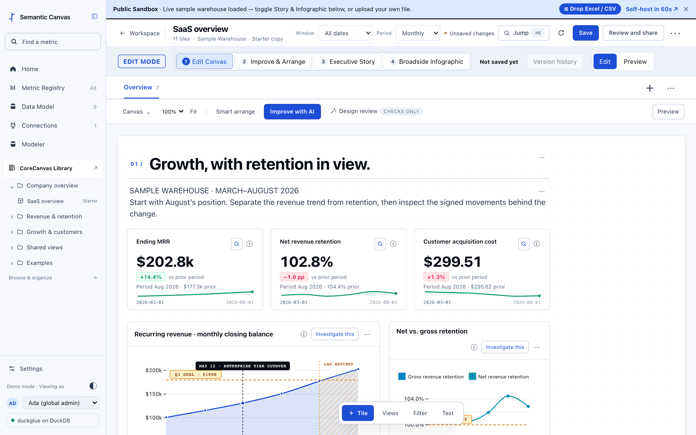
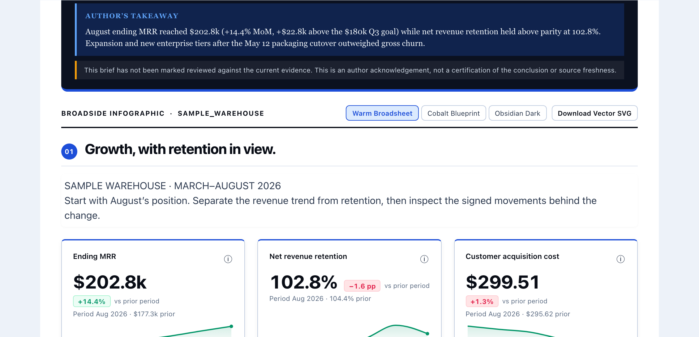

# Semantic Canvas (`v0.3.6`)

**Open-source governed BI studio (MIT)** that turns spreadsheets, SQL warehouses, or semantic YAML (`duckglue`, `dbt`, `cube`, `snowflake-semantic`) into parameterized SQL and three synchronized publication views: an interactive **Dashboard**, a narrative **Executive Story**, and a **Broadside Infographic**.

- **Try it live (zero install):** [Public Sandbox](https://sandbox-production-357b5956.up.railway.app) (pre-loaded DuckDB sample warehouse + session-isolated `.xlsx`/`.csv` upload)
- **Interactive Tour & Architecture:** [semanticcanvas.ai](https://semanticcanvas.ai)
- **Self-host in 60 seconds:** `docker compose up --build -d`


*Interactive Broadside dashboard (`$202.8k` Ending MRR, `102.8%` NRR, `$299.51` CAC) compiled locally against the sample DuckDB warehouse with partial-period hatching, goal thresholds, Global Date Window filtering, and 0 AI keys required.*


*One click converts the exact same governed queries and filters into a Broadside Infographic with Warm Broadsheet, Cobalt Blueprint, or Obsidian Dark themes, composite vector SVG export, PNG export, Print/PDF, and SHA-256 snapshot integrity checks.*

## Broadside Design Philosophy ("Honesty Made Visible")

Semantic Canvas avoids unverified text-to-SQL guesswork and dashboard bloat:

1. **One SQL compiler, three views:** **Dashboard** (spatial layout + drills), **Executive Story** (question, takeaway, next step, consolidated data notes), and **Broadside Infographic** (condensed visual brief + vector SVG) query the exact same compiled SQL.
2. **Uncertainty is drawn, not hidden:** Incomplete trailing/leading date buckets render diagonal hatching (`reportingLag`), policy cutovers render dashed rules, unsupported snapshot sums and 1:N fan-out joins are caught before double-counting, and missing/incomplete series surface explicit caveats.
3. **Zero-key deterministic core:** Metric exploration, 5-dialect YAML conversion, Structural Readiness Coaching (`0–100`), messy-Excel cleaning, period-over-period driver attribution, prompt-to-dashboard composition, and Smart Arrange run with zero LLM calls. When AI redesign is enabled, numeric claims in the AI's rationale are cross-checked against warehouse query outputs before applying.

## What's in `v0.3.6`

### 1. Live Warehouses, Messy Spreadsheets & SQL Engine
- **Warehouse Connectors:** Parameterized SQL execution against **DuckDB**, **PostgreSQL** (Supabase, Neon, AWS RDS — with Postgres OID normalization for `NUMERIC`, `INT8`, and `DATE`), **Google BigQuery**, **Snowflake**, **SQLite (`.db`)**, and **Parquet/CSV** lakes (local or S3 via AWS profile / STS).
- **Messy Corporate Excel & Duplicate-Key Join Guard:** Upload raw `.xlsx` or `.csv` files directly into the Modeler or Public Sandbox. Automatically skips leading report/title banners, strips summary rows/columns (`Total`, `Subtotal`, `Q1 Total`, `YTD`) to prevent double-counting, scrubs `#N/A`/`#DIV/0!`/`#REF!`, unpivots wide monthly/quarterly header columns (`Jan 2026`, `Q1 2026`) with automatic period grain detection, checks cross-sheet joins for duplicate right-side keys and orphan foreign keys, and records a visible cleaning banner (`cleaningNotes`).
- **Global Date Window & Instant PDF Export:** Top-bar global date window presets (`Last 3 months`, `Last 6 months`, `YTD`, `Last 12 months`, `All dates`) scoped dynamically to each source's anchor date, plus print-ready **Print / Save PDF** CSS output in Review & Share.
- **Compiled SQL & Lineage DAG Inspector (`POST /api/query/lineage`):** Inspect generated SQL, join traversal, enforced RLS predicates, and table-to-metric dependencies per chart.
- **Universal 5-Dialect Semantic Layer Converter & Coach (`npm run semantic`):** Convert models across **DuckGlue**, **Snowflake Cortex Analyst**, **dbt MetricFlow**, **AWS Glue Data Catalog**, and **Cube** (`--from auto --to <dialect>`), score structural readiness (`--fail-under 85` CI gate), and generate YAML fix recipes. See [multi-dialect conversion, coaching & CLI](docs/semantic-layer-conversion.md).

### 2. Design, Storytelling & Verifiable Publications
- **Centered Detail Sub-Dashboards & Smart Story Details:** Click any KPI value or chart to open a centered Broadside sub-dashboard with governed movement bridges (`Metric.explorations`), **1-Click Story Arcs** (*Executive Pulse*, *Why Did It Move?*, *Stakeholder & Finance Pack*), and zero-AI SQL mover attribution (`✦ Smart-add story details`). See [detail dashboards & smart story subdetails](docs/metric-exploration.md).
- **4 Canvas Themes & 3 Poster Themes:** Canvas theme presets (`broadside`, `newsroom-dark`, `swiss-grid`, `studio-warm`) plus Infographic poster themes (`Warm Broadsheet`, `Cobalt Blueprint`, `Obsidian Dark`), composite multi-tile Vector SVG export, PNG export, and 2-way Dashboard-as-Code YAML sync (`GET /api/dashboards/:id/yaml`, `POST /api/dashboards/import-yaml`).
- **Snapshot Integrity Checksums (`POST /api/dashboards/:id/digest`):** Records and displays a verified SHA-256 digest over chart queries, RLS scopes, warehouse results, and reviewed takeaways; automatically flags `Review needed` if underlying numbers or text change after review.
- **18-Chart Sketch & PDF Reference Recreation:** Map a whiteboard photo, dashboard screenshot, PDF, or 1-click zero-key sample blueprint onto governed catalog metrics with fuzzy field matching and 12-column grid snapping.

### 3. Enterprise Governance, MCP & Public Sandbox
- **Fail-Closed Row-Level Security & Identity:** Server-enforced RLS across charts, driver analysis, filters, and remote MCP, plus **OIDC sign-in** (`SC_MODE=team`), **SCIM 2.0 (`/api/scim/v2`)** persisted to `SC_DATA_DIR/scim.json` (`SC_SCIM_TOKEN`, immediately revoking sessions and blocking sign-in when `active: false`), optional AES-256-GCM encrypted persistent sessions (`SC_SESSION_SECRET` + `SC_DATA_DIR`), hot-reloaded `access.yaml`, and OpenTelemetry log/trace export.
- **13 Governed MCP Tools (Local Stdio + Remote HTTP):** Copy-ready setup in **Connections** for Claude Code, Claude Desktop, OpenAI Codex CLI, Cursor, Antigravity, VS Code, Gemini CLI, and ChatGPT Secure MCP Tunnels (`npm run mcp`), alongside authenticated principal-scoped Remote HTTP MCP (`POST /api/mcp`).
- **Session-Isolated Public Sandbox (`SC_SANDBOX_MODE=true`):** Safe unauthenticated demo mode with per-visitor `HttpOnly` session cookies (`sc_sandbox_sid`) isolating uploaded spreadsheets across visitors, read-only protection of shared dashboards/library/starters, same-origin CSRF allowlisting (`SC_SANDBOX_ORIGINS`), proxy-aware upload/query rate limiting, hard blocks on warehouse/AI-key/audit/MCP mutations, and automatic FIFO eviction of old ephemeral uploads.

## Deliberate Non-Goals & Where This Stops

Thoughtful BI requires being clear about what a tool refuses to guess or automate:

1. **No ad-hoc LLM SQL against raw tables:** Uploaded spreadsheets never run unverified LLM-generated SQL—they are deterministically profiled, cleaned, checked for duplicate join keys, and compiled through the governed semantic model (via 1-click Clean & Open or interactive column/join review), while unreviewed warehouse tables stay hidden from company viewers until published by an administrator.
2. **No autonomous task-bot mutations in external systems:** Executive Story & Infographic briefs record a clear next action and owner inside the document without autonomously creating Jira tickets or HubSpot tasks. (Optional threshold/anomaly chart watches evaluate governed queries in-app and only POST to an explicit `SC_ALERT_WEBHOOK_URL` if configured by an operator.)
3. **SHA-256 verifies snapshot integrity, not truth:** A matching SHA-256 digest proves the snapshot's queries, scopes, warehouse payload, and reviewed prose did not change since sign-off. It does **not** certify upstream ETL pipeline completeness or causal correctness. (Trailing partial periods remain visually flagged; `Coverage unverified` is displayed honestly.)
4. **Local SQL compiler, not remote vendor proxy:** Importing `dbt`, `Cube`, or `snowflake-semantic` compiles SQL locally against your configured database—it does not guarantee 100% behavioral parity with every vendor's proprietary runtime.

## Part of the Semantic Canvas suite

Semantic Canvas can run standalone (all instructions below) or alongside Ingest and Gateway in the suite architecture. See [suite packaging and integration status](docs/suite-packaging.md) and the [Gateway/Ingest repository](https://github.com/Evinanderson89/gateway-platform).

## Run it

**Try the zero-install live sandbox:** open [https://sandbox-production-357b5956.up.railway.app](https://sandbox-production-357b5956.up.railway.app) to inspect the pre-loaded `SaaS overview` workbook, switch between Dashboard / Story / Poster, or upload a messy `.xlsx`/`.csv` into your isolated browser session.

Or run locally with Docker (60 seconds):

```sh
git clone https://github.com/Evinanderson89/semantic-canvas.git
cd semantic-canvas
docker compose up --build -d
```

**Before-and-after walkthrough:** On Home (or via **Workspace Library → Examples → Dashboard cleanup demo**), open **Improve** (`Generate deterministic draft from prompt` works with zero API keys, or configure an AI provider), use **Arrange & Layout → Tell a story**, then switch across **Dashboard**, **Story**, and **Poster** and export a PNG/SVG/PDF. See [presentation and evidence behavior](docs/presentations.md).

Open [the local demo](http://localhost:5173). Dashboard storage persists in a named volume. For HTTPS company deployment, SSO, logging and recovery, follow the [self-hosting guide](docs/self-hosting.md).

For local development (Node.js 22.12+, 24.x, or 26.x):

```sh
npm ci
npm start
```

Open [Semantic Canvas](http://127.0.0.1:5173). The API runs at `127.0.0.1:5174`. The bundled sample warehouse needs no credentials.

## Connect a source

Open **Connections** to add, edit or select a source, or edit `sources.yaml` (using your read-only warehouse role). A source pairs a semantic adapter with a warehouse connector.

| Adapter | Supported import | Explicitly unsupported |
| --- | --- | --- |
| `duckglue` | Bundled YAML model, trusted metric expressions and declared forward join paths, including multiple hops; ratio, derived and cumulative metrics (`docs/metric-types.md`) | Ambiguous shortest paths, reverse traversal, and declared joins that multiply base rows; see [joins](docs/joins.md) |
| `dbt` | `simple`, `ratio`, `derived`, and `cumulative` metrics backed by supported column aggregates in `semantic_manifest.json` | Conversion metrics; non-additive measures; arbitrary SQL metric filters |
| `cube` | Cube `measures`, `dimensions`, `segments`, and time dimensions from YAML/JSON model files | Custom JS dynamic schemas, pre-aggregations, and arbitrary multi-hop reverse joins |
| `snowflake-semantic` | Public plain-column fields and table-level metrics, composite equality join keys, left/inner joins, database/schema qualification | Computed fields, filters, non-additive rules, private access, variables, explicit metric join paths, SQL-defined tables, range/asof joins, top-level derived metrics, repeated physical table names with different aliases |

Unsupported imports return a source error explaining what could not be represented. Adapters import model definitions locally and compile parameterized SQL rather than delegating to an external vendor runtime.

Connectors: **DuckDB**, **PostgreSQL**, **Google BigQuery**, **Snowflake**, **SQLite (`.db`)**, and **Parquet/CSV** through DuckDB (local directory, uploaded `.xlsx`/`.csv`, or S3 lake via `awsProfile` + `awsRegion` in `~/.aws/config`). Keep personal credentials out of tracked `sources.yaml`; see `sources.personal.local` instructions below.

## AI and MCP

AI is optional. The canvas, deterministic draft composer, messy-spreadsheet cleaner, driver attribution, Coach, and 5-dialect compiler work with **zero AI keys**. When enabled, choose `anthropic` (Claude), `openai`, `gemini`, or any `openai-compatible` endpoint via **Connections** or `.env`. Credentials stay on the server; in company modes (`SC_MODE=team` or `gateway`), private/loopback `ai.baseUrl` addresses are blocked unless `SC_ALLOW_PRIVATE_AI_URL=true`.

Embedded tools and conversation histories are bound to the selected source and principal; in company mode, they also carry the authenticated caller’s session and are isolated by user. A model cannot switch that scope by changing its tool arguments. AI recommendations still need human judgment; they are not proof of causation or business correctness.

**Connect Claude Desktop or Claude Code:** open **Connections → Connect Claude**. Choose your client and copy the generated setup. It uses absolute paths and the running API’s port, so it also works when Claude starts outside this repository. Keep Canvas running on the same computer as Claude. No Anthropic API key is needed in Canvas for this connection.

The panel includes a local MCP connection check and a starter prompt. The check launches the MCP server, discovers its tools, and reads the selected source’s metric definitions. It does not contact an AI provider or verify that your Claude client is connected. Confirm that separately in Claude Desktop’s connector settings or Claude Code’s `/mcp` view.

Claude can save directly through these tools. Ask it to propose changes before saving, and use a new dashboard ID when exploring. Refresh Canvas and open the saved dashboard from its library; MCP does not edit your browser’s unsaved canvas. Generated configuration is specific to this installation; regenerate it if the repository, Node installation, or API port moves. Merge configuration entries rather than replacing other MCP servers. For authenticated company-mode MCP access over HTTPS, use `POST /api/mcp`.

**Connect ChatGPT:** open **Connections → Connect ChatGPT**. The setup uses [OpenAI’s Secure MCP Tunnel](https://developers.openai.com/api/docs/guides/secure-mcp-tunnels) and a separate scoped stdio server. Choose a source and row-access principal. Explore-only mode exposes eight read tools; build mode adds dashboard save and arrangement. The scope is enforced by the server, including refusing missing principals and tool requests for another source or principal. Everyone using that tunnel shares the chosen local scope. Company sign-in delegation is not supported.

The panel generates macOS/Linux tunnel commands and checks the local MCP handshake. Completing the connection also requires OpenAI tunnel permissions, a runtime tunnel credential, and custom MCP access in the intended ChatGPT workspace. Canvas never collects that credential. The local check does not establish a tunnel or certify ChatGPT connectivity; verify by querying metrics from ChatGPT. See the in-app steps for connecting and stopping the client. No OpenAI model API integration is required.

For other local MCP clients, the stdio entry point is:

```sh
npm run mcp
```

The MCP server exposes catalog discovery, scoped queries, dashboard save/open, layout selection and user questions through the same HTTP API. External stdio MCP clients are trusted local clients and may explicitly select simulated roles; company mode requires an authenticated session via `POST /api/mcp`.

To update a saved dashboard, call `get_dashboard` and pass its `revision` into `save_dashboard`; revision `0` creates a new document. Both tools accept a `source`. Set `SEMANTIC_CANVAS_URL` when the API uses a different port.

## Data and recovery

**Edit, Preview, and version history:** the dashboard mode bar identifies editable drafts and read-only previews. Preview does not save or publish. After the first save, **Version history** lists saved designs with timestamps and a layout preview. Before restoring, compare the selected version against current work, including unsaved edits: data and scope changes are shown separately from story content and visual changes, with current and saved values side by side. **Restore as draft** preserves the existing history and opens the chosen design for a new save. History stores chart definitions, layout, authored text and saved filters; warehouse data and semantic definitions remain live. Versions overwritten before this feature are unavailable.

Saved dashboards, chart conversations, and personal alert rules/history live in `~/.semantic-canvas/dashboards.duckdb`. Set `SC_DATA_DIR` to choose another directory. Unsaved recovery drafts are stored in this browser and appear on Home; they do not include query result rows or connection credentials. If browser recovery fails, internal navigation keeps the current document open and offers a downloadable JSON backup. Use **Import backup** on Home to restore it as a new document. Save larger image-heavy documents explicitly; browser storage has a quota.

In Docker, data lives under `/data` in the persistent workspace volume. Company-mode drafts use account-specific tab session storage and are removed from that tab on sign-out. Administrators can download a consistent library snapshot; offline restore validates it and requires an empty store. See [backup and restore](docs/self-hosting.md#back-up-restore-and-upgrade).

Before upgrading an existing installation, stop its server and back up the dashboard directory. The newer DuckDB engine and additive store migration are tested with the old schema. Older application versions may not understand the updated database format or source ownership fields.

Legacy dashboards are attached to a source only when their old model name identifies exactly one source. Ambiguous records are retained in the store for explicit recovery; they are not assigned by guesswork.

## Development

```sh
npm run typecheck
npm test
npx playwright install chromium
npm run e2e
npm run build
```

Browser tests start their own servers on ports 5273/5274 and use `.test-data/` for saves. They do not require the normal app to be running. CI runs type checking, the result and regression tests, a production build and browser tests.

| Directory | Responsibility |
| --- | --- |
| `src/semantic` | Model imports and join metadata |
| `src/compiler` | Runtime document/query schemas, semantic validation and SQL compilation |
| `src/security` | Company authentication, SCIM 2.0, sandbox guards, policy loading and query scope |
| `src/operations`, `deploy` | Structured telemetry, release manifest and self-hosting recipes |
| `src/store` | Document migration, encrypted session/lease persistence, source isolation and atomic revision checks |
| `src/app`, `src/canvas` | Editing, document recovery, chart controls and canvas geometry |
| `src/suggest`, `src/charts` | Suggestions and rendering |
| `src/agent`, `src/mcp` | Embedded AI and external agent tools |

## Next

Native semantic-layer execution, completeness metadata, multi-node horizontal scaling over a shared database, finer per-document ACLs, and real-time collaborative editing remain future work. Company mode runs as a single-workspace deployment with OIDC sign-in, optional encrypted session persistence (`SC_SESSION_SECRET`), and SCIM 2.0 user/group provisioning (`SC_SCIM_TOKEN`); test against your live identity provider before broad enterprise rollout.

See [architecture and contracts](docs/architecture.md), [contributing](CONTRIBUTING.md), [security](SECURITY.md), and [release notes](CHANGELOG.md). MIT licensed. See [LICENSE](LICENSE).

## Workspace Library

**Workspace Library** in the sidebar is the workspace home for saved dashboards and reusable views. Create folders and subfolders, search across the library, and use each item's menu to rename or move it. The library organizes Company overview, Revenue & retention, Growth & customers, Shared views (KPI summaries, Trends & comparisons, Story sections), and Examples. On first setup, unfiled dashboards using these topics move into the matching folder; existing folder choices and dashboard contents stay intact. Other dashboards stay at the root. The sample catalogue includes ten live starter dashboards in these folders. Eight use curated compositions: revenue waterfalls, geographic signup maps, product heatmaps, channel small multiples, subscription mix, scatter comparisons, and acquisition funnels. Starters open as independent copies (built-in templates cannot be overwritten or renamed in place): save to keep your version, and reopen **Examples → Dashboard cleanup demo** for a fresh before-and-after exercise. Examples and Shared views start collapsed. Folders, starters, and setup state persist in the library database and backups.

On a dashboard, open **Views → Save a view** to persist selected tiles or the current tab, including labels, section relationships, formatting, layout, and saved filter defaults. Selecting a heading includes its section. Use **Views → Browse saved views** to insert a copy into the current tab, or preview a view from the library and use it as a new dashboard. Metrics run against the current semantic catalogue and the viewer's permissions. Insertion uses fresh tile/filter IDs, preserves the destination's existing content, fits wider views when needed, and supports one-step undo. Copied filters apply only to the copied tiles and stay visible in the filter shelf when they have no canvas control.

The library persists in the server's `dashboards.duckdb`, alongside dashboards; it is included in library backup/restore. It stores definitions and authored content, not cached result rows or connection credentials. Folders are scoped to the source and organize shared work; they are not access-control boundaries. Company viewers can browse/open work, while editors and administrators can save and organize it. Writes reject stale revisions, cross-source moves and folder cycles; only empty folders can be deleted.

Saved views are independent snapshots, not linked components: later changes do not propagate to dashboards where a view was inserted. Temporary filter selections, cross-filtering, drill-downs, comments and alert rules are not carried into a saved view. Model migrations and cross-source remapping remain explicit future work.

## Chart comments and alerts

Enable **Chart chats** and **Chart notifications** independently in **Settings → Chart tools**, available from the sidebar or **Canvas → Chart tools & notifications**. Both are off by default. These are personal display preferences saved in this browser per signed-in user (or local role preview), across dashboards. Hiding a tool keeps its conversations and alert rules; existing watches continue to run. To stop checks, pause the watch from its chart's bell. These preferences do not change shared dashboard documents or grant access to data.

When enabled, the message and bell icons appear in the upper-right corner of metric charts, including KPI cards. Save the dashboard first. Comments are plain text with replies and resolution; author names come from company sign-in. Conversations are shared within the same source and RLS scope. Alert rules and observed values are private to their owner. Copies of a dashboard or chart start their own activity, and deleting a chart from a saved dashboard removes its activity.

Alerts support a threshold above/below a value and an anomaly check for a single time series. They query the saved metric through the semantic compiler, with saved filter defaults and server-enforced RLS. Changing the saved query or semantic model requires reviewing the watch. Live cross-filtering and drilling do not alter it. Preview a check before saving, check now, pause/resume, and mark updates read. The bell has a small unread dot; it does not repeatedly notify on every check of the same ongoing breach. The last 30 triggered observations are retained.

Checks run in the Node server every 15 minutes, hour, or day, with a scheduler sweep once a minute. Keep the server running. In company mode, an owner's unexpired authenticated session and current source access are required; checks pause until sign-in resumes. In gateway mode a watch also pauses after a server restart until its owner has opened Canvas with a valid Gateway session. Notification delivery is **in-app by default**, with optional operator-configured webhook delivery via `SC_ALERT_WEBHOOK_URL` (no autonomous email or browser push is configured).

Time-series checks skip the current UTC calendar period and wait for the most recently closed period. Nulls, missing periods, duplicate dates, stale data, and insufficient history produce a waiting state. Anomaly checks need 14 closed periods, use up to 60 prior observations, and compare against the median historical change with a scaled median absolute deviation range. Daily series use week-over-week changes once four weeks of history exist. Sensitivity adjusts the range, with a 1% floor for flat baselines. The range is an investigation aid, not a statistical confidence interval, and source completeness remains unverified. See the [NIST description of scaled MAD](https://www.itl.nist.gov/div898/software/dataplot/refman2/auxillar/mad.htm).

Library backups include conversations and alert observations, so handle them as company data. Restoring a library pauses all watches for review. Existing library backups without activity still restore correctly. Keep the same source and RLS configuration to recover the matching discussion scope.

### Personal source configuration

Keep personal connections out of tracked `sources.yaml`. Copy it to `sources.personal.local` (ignored by Git), add the connection there, and run `SOURCES_PATH=./sources.personal.local npm start`. When using the Connections form, start with this local configuration path too. The default configuration stays sample-only for walkthroughs.
